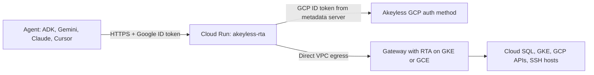

# Deploy the RTA MCP server to Cloud Run



Finish [AKEYLESS_SETUP.md](AKEYLESS_SETUP.md) first.

## Option A: script

```bash
export PROJECT_ID=my-project REGION=europe-west1
export NETWORK=default SUBNET=default
export AKEYLESS_GATEWAY_URL=https://10.0.0.5:8000
export AKEYLESS_ACCESS_ID=p-xxxxx
export INVOKER_MEMBERS="serviceAccount:my-agent@my-project.iam.gserviceaccount.com"

./deploy/deploy.sh
```

The script creates the service account and Artifact Registry repo if missing, builds the image with Cloud Build, and deploys with:

| Flag | Why |
|------|-----|
| `--service-account` | Identity bound in the Akeyless GCP auth method |
| `--no-allow-unauthenticated` | Only IAM-authorized callers can reach the tools |
| `--ingress internal` | Default; set `INGRESS=all` only if callers are outside the VPC |
| `--network/--subnet --vpc-egress private-ranges-only` | Reach a private Gateway; other traffic goes out normally. Leave `NETWORK` and `SUBNET` unset when the Gateway has a public address (for example a Gateway in another cloud). |
| `--timeout 300` | Longer than the 270 s RTA request timeout |

It then grants `roles/run.invoker` to each member in `INVOKER_MEMBERS`.

## Option B: Terraform

```bash
cd deploy/terraform
terraform init
terraform apply \
  -var project_id=my-project -var region=europe-west1 \
  -var image=europe-west1-docker.pkg.dev/my-project/akeyless/akeyless-rta:TAG \
  -var network=default -var subnet=default \
  -var akeyless_gateway_url=https://10.0.0.5:8000 \
  -var akeyless_access_id=p-xxxxx \
  -var 'invoker_members=["serviceAccount:my-agent@my-project.iam.gserviceaccount.com"]'
```

The variables reject `api.akeyless.io` and public invokers (`allUsers`, `allAuthenticatedUsers`).

## Environment variables

| Variable | Default | Notes |
|----------|---------|-------|
| `AKEYLESS_GATEWAY_URL` | (required) | Customer Gateway with RTA, `https://host:8000` or `.../api/v2` |
| `AKEYLESS_ACCESS_ID` | (required) | GCP auth method access ID |
| `AKEYLESS_ACCESS_TYPE` | `gcp` | Also `access_key`, `universal_identity`, `jwt` |
| `AKEYLESS_GCP_AUDIENCE` | `akeyless.io` | Must match the auth method audience |
| `AKEYLESS_CA_BUNDLE` | — | PEM file for a privately signed Gateway certificate |
| `AKEYLESS_DEFAULT_SECRET_NAME` | — | Pin the service to one secret; hides `list-secrets` |
| `AKEYLESS_AGENT_ID` | `cloud-run` | Default audit agent ID |
| `AKEYLESS_MCP_ID` | `akeyless-cloudrun-rta` | `auto` generates a UUID per process |
| `PORT` | `8080` | Set by Cloud Run |

## Connect a client

The MCP endpoint is `https://SERVICE_URL/mcp` (stateless streamable HTTP).

- **ADK / code**: send `Authorization: Bearer <Google ID token for SERVICE_URL>`. See [examples/adk-agent/mcp_agent](../examples/adk-agent/mcp_agent/agent.py).
- **Local MCP clients (Claude, Cursor)**: run a proxy that adds your identity, then point the client at `http://localhost:8080/mcp`:

  ```bash
  gcloud run services proxy akeyless-rta --region europe-west1 --port 8080
  ```

  With `--ingress internal`, the proxy only works from inside the VPC (or via a VPN / Cloud Interconnect).

## Audit

Every call sends `original_user` to the Gateway. When the request carries a Google ID token, the server adds the invoker's email, for example `alice@example.com (via my-agent@proj.iam.gserviceaccount.com)`. Cloud Run IAM has already checked the token at that point; the email is used for audit only.
