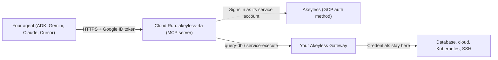

# User guide: Akeyless Agentic Runtime Authority on Google Cloud Run

This guide takes you from nothing to an AI agent on Google Cloud that queries a real database **without ever holding a credential**. It takes about 20 minutes if you already have an Akeyless Gateway.

## How it works



1. Your agent calls a tool such as `query-db` on the Cloud Run service. Cloud Run lets the call through only if the caller has the **invoker** role.
2. The service signs in to Akeyless as **its own service account**. Its configuration holds no keys or passwords, only a Gateway URL and an Access ID.
3. The **Gateway** checks the request against the secret's **agentic rules**, runs it with credentials it keeps to itself, and returns only the results.
4. Every call is written to the **Akeyless audit log** with the agent ID, the original user and the original prompt.

## What you need

| Item | Notes |
|------|-------|
| Google Cloud project | With Cloud Run, Cloud Build and Artifact Registry APIs enabled |
| `gcloud` CLI | Signed in with rights to deploy Cloud Run and create service accounts |
| Akeyless account and `akeyless` CLI | Rights to create auth methods and roles |
| Akeyless Gateway with Agentic Runtime Authority | Customer or self-hosted. `https://api.akeyless.io` does **not** work: the SaaS API doesn't host the execute endpoints, and the package rejects it |
| A dynamic or rotated secret | For example a MySQL dynamic secret the Gateway can reach |

## Step 1: Create the service account

The Cloud Run service uses this identity to sign in to Akeyless. Use one service account (and one Akeyless role) per trust boundary.

```bash
export PROJECT_ID=my-project REGION=europe-west1
gcloud iam service-accounts create akeyless-rta \
  --project "$PROJECT_ID" --display-name "Akeyless RTA (Cloud Run)"
```

## Step 2: Set up Akeyless

**Create a GCP auth method** bound to that service account:

```bash
akeyless auth-method create gcp \
  --name /cloud-run-rta \
  --type iam \
  --audience akeyless.io \
  --bound-projects "$PROJECT_ID" \
  --bound-service-accounts "akeyless-rta@${PROJECT_ID}.iam.gserviceaccount.com"
```

Save the returned Access ID (`p-…`). It's not a secret, but it is the only Akeyless setting the service needs.

**Create a role** that allows agentic access to your secret, and attach the auth method:

```bash
akeyless create-role --name cloud-run-rta
akeyless set-role-rule --role-name cloud-run-rta \
  --path /prod/mysql-dynamic --capability allow_access --rule-type ara-rule
akeyless assoc-role-am --role-name cloud-run-rta --am-name /cloud-run-rta
```

Keep the role narrow. Every caller of the Cloud Run service acts with it.

**Turn on Agentic Runtime Authority on the secret and add rules.** Rules are plain-language checks that the Gateway enforces before it runs anything. These are the ones from the demo:

```bash
akeyless update-item --name /prod/mysql-dynamic --ara-enabled true \
  --input-rule "name=read-only-sql,rule=Only allow read-only SQL statements: SELECT, SHOW, DESCRIBE, DESC, EXPLAIN. Reject any DML or DDL (INSERT, UPDATE, DELETE, DROP, ALTER, CREATE, TRUNCATE, GRANT, REVOKE)." \
  --input-rule "name=no-salary-data,rule=Reject any query that selects, reads, or exposes the salary column." \
  --input-rule "name=no-multi-statement,rule=Reject multi-statement queries (multiple statements separated by semicolons)."
```

You can also do all of this in the Akeyless Console. Open the secret, enable Agentic Runtime Authority, and add the rules under **Input Rules**.

## Step 3: Deploy to Cloud Run

From a clone of this repo:

```bash
export PROJECT_ID=my-project REGION=europe-west1
export AKEYLESS_GATEWAY_URL=https://gw.example.internal:8000
export AKEYLESS_ACCESS_ID=p-xxxxx
export INVOKER_MEMBERS="serviceAccount:my-agent@${PROJECT_ID}.iam.gserviceaccount.com user:me@example.com"

# Private Gateway in your VPC: set both. Public Gateway: leave both unset.
export NETWORK=default SUBNET=default

./deploy/deploy.sh
```

The script builds the image with Cloud Build, pushes it to Artifact Registry and deploys it with safe defaults:

- **No public access** (`--no-allow-unauthenticated`). Only the members in `INVOKER_MEMBERS` get `roles/run.invoker`.
- **Internal ingress** by default. Set `INGRESS=all` only if your agent runs outside the VPC (for example on a laptop).
- **VPC egress to private ranges only**, when `NETWORK` and `SUBNET` are set.

If you prefer Terraform, use [`deploy/terraform`](../deploy/terraform). See [CLOUD_RUN_DEPLOY.md](CLOUD_RUN_DEPLOY.md).

**Useful optional settings** (pass them as env vars to the script or the service):

| Variable | Use it to |
|----------|-----------|
| `AKEYLESS_DEFAULT_SECRET_NAME` | Pin the service to one secret. This also hides `list-secrets` |
| `AKEYLESS_CA_BUNDLE` | Trust a privately signed Gateway certificate. TLS checks are never disabled |
| `AKEYLESS_AGENT_ID` | Set the default agent ID shown in the audit log |

## Step 4: Connect your agent

The MCP endpoint is `https://SERVICE_URL/mcp`, served over streamable HTTP. Every request needs a Google ID token for the service URL.

**Google ADK (Gemini on Vertex AI):**

```python
import subprocess
from google.adk.agents import LlmAgent
from google.adk.tools.mcp_tool.mcp_session_manager import StreamableHTTPConnectionParams
from google.adk.tools.mcp_tool.mcp_toolset import McpToolset

SERVICE_URL = "https://akeyless-rta-xxxxx.europe-west1.run.app"

def invoker_headers(_ctx=None):
    token = subprocess.run(["gcloud", "auth", "print-identity-token"],
                           capture_output=True, text=True, check=True).stdout.strip()
    return {"Authorization": f"Bearer {token}"}

toolset = McpToolset(
    connection_params=StreamableHTTPConnectionParams(
        url=f"{SERVICE_URL}/mcp", headers=invoker_headers(), timeout=60),
    header_provider=invoker_headers,
)
agent = LlmAgent(name="db_agent", model="gemini-…", tools=[toolset],
                 instruction="Use the Akeyless tools to answer questions about the database.")
```

Keep in mind:
- Pass the token in **both** `headers` and `header_provider`. ADK opens the first MCP session before it calls `header_provider`.
- ID tokens expire after about an hour, so cache the token and refresh it before then.
- On Cloud Run or GKE, get the token from the metadata server with `google.oauth2.id_token.fetch_id_token(request, SERVICE_URL)` instead of `gcloud`. On a laptop signed in with your own Google account, that call fails, so use `gcloud auth print-identity-token` there.
- Use a Gemini model that's enabled in your project. You can list the available ones in Vertex AI Model Garden.

**Claude Desktop, Cursor or any other local MCP client:** run a proxy that adds your identity, then point the client at `http://localhost:8080/mcp`:

```bash
gcloud run services proxy akeyless-rta --region "$REGION" --port 8080
```

With internal ingress, the proxy only works from inside the VPC (or over VPN or Interconnect).

## Step 5: Use it

The agent gets four tools:

| Tool | What it does |
|------|--------------|
| `list-secrets` | Lists the secrets the agent may use: names and types only, never values |
| `query-db` | Runs a SQL or NoSQL query on a database secret. The Gateway returns the rows |
| `service-execute` | Runs a cloud, Kubernetes, GitHub, custom MCP or remote command action |
| `list-sub-tools` | Discovers the actions available on service secrets and remote items |

What the demo looked like with the rules above:

| The agent asked | Result |
|-----------------|--------|
| "Which tables are in the database? List the first five employees with name and email" | **Allowed.** Real rows come back |
| "Delete employee 12" | **Denied** by `read-only-sql`. Nothing runs |
| "Who are the three highest-paid employees?" | **Denied** by `no-salary-data` |
| Two statements in one query | **Denied** by `no-multi-statement` |
| "Give me the MySQL username and password" | **Nothing to give.** The agent never holds the credentials |

For a clean audit trail, have your agent pass `agent-id`, `original-user` and `original-prompt` on each tool call. When a request carries a Google ID token, the server also records the caller's email.

## Step 6: Check the audit log

In the Akeyless Console, open **Logs**. You'll see one entry for each tool call, with the agent ID, the original user, the prompt, the secret used and whether the call was allowed or denied.

## Embedded mode (no MCP server)

If your agent already runs on Cloud Run, you can skip the MCP server and call the library directly:

```bash
pip install akeyless-cloudrun-rta
```

```python
from akeyless_cloudrun_rta import AkeylessRtaClient

client = AkeylessRtaClient()  # reads AKEYLESS_GATEWAY_URL and AKEYLESS_ACCESS_ID from env
result = client.query_db("SELECT count(*) FROM orders", secret_name="/prod/orders-db")
print(result.results)
```

The agent's own service account must then be the one bound in the GCP auth method.

## Troubleshooting

| Symptom | Likely cause and fix |
|---------|---------------------|
| `403` from Cloud Run | The caller lacks `roles/run.invoker`, or the token's audience isn't the service URL |
| MCP session fails at startup | The ID token isn't in the static `headers` (see Step 4) |
| Akeyless sign-in fails | The service account doesn't match `--bound-service-accounts`, or the audience differs from `AKEYLESS_GCP_AUDIENCE` |
| `list-secrets` is empty | The role is missing the `ara-rule` / `allow_access` rule, or Agentic Runtime Authority isn't enabled on the secret |
| Timeouts reaching the Gateway | VPC egress isn't set for a private Gateway, or a firewall blocks port 8000 |
| TLS error | The Gateway certificate is privately signed: set `AKEYLESS_CA_BUNDLE` |
| Denial message says "Rule 1" instead of the rule's name | That's how the Gateway reports denials today. Rules are numbered in the order they're listed on the secret |

## Clean up

```bash
gcloud run services delete akeyless-rta --region "$REGION" --project "$PROJECT_ID"
gcloud iam service-accounts delete "akeyless-rta@${PROJECT_ID}.iam.gserviceaccount.com" --project "$PROJECT_ID"
gcloud artifacts repositories delete akeyless --location "$REGION" --project "$PROJECT_ID"
akeyless delete-role --name cloud-run-rta
akeyless delete-auth-method --name /cloud-run-rta
```
